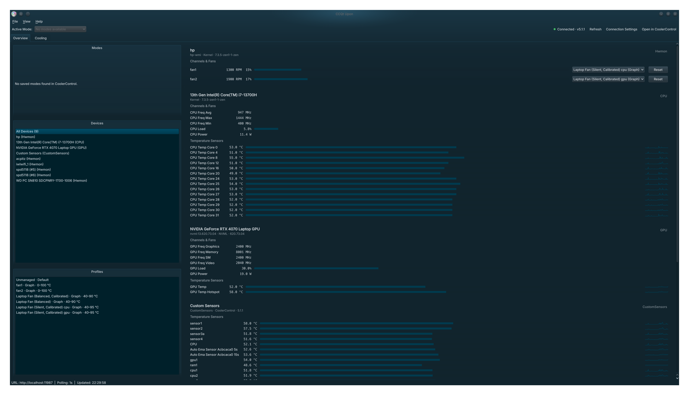
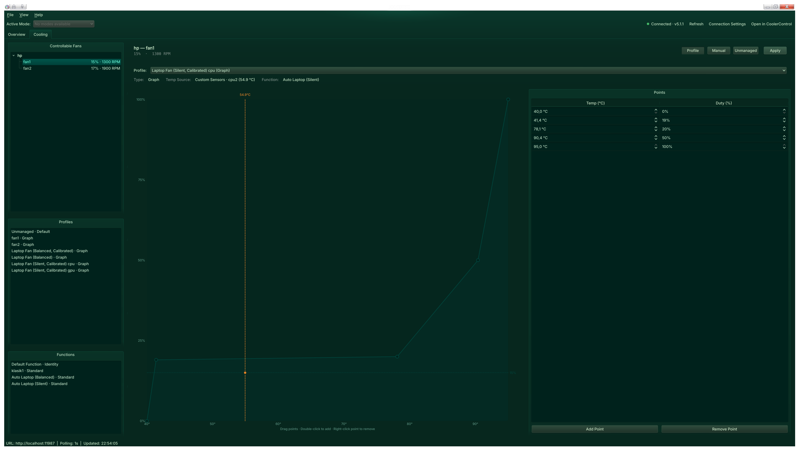
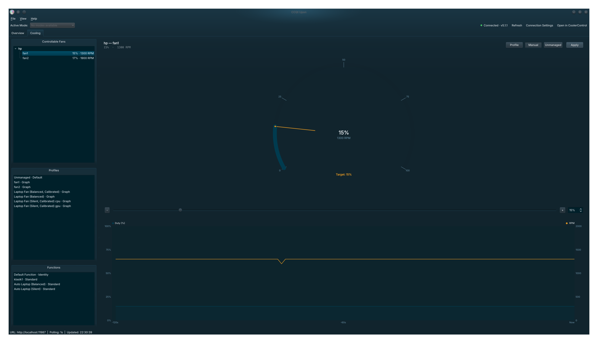
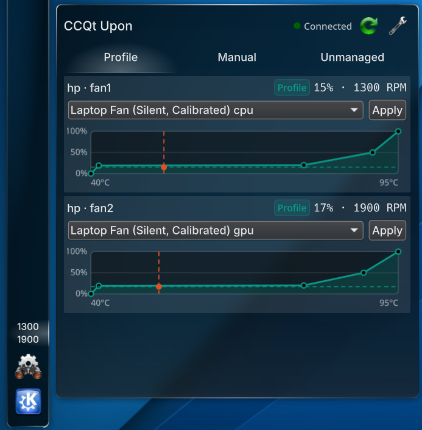
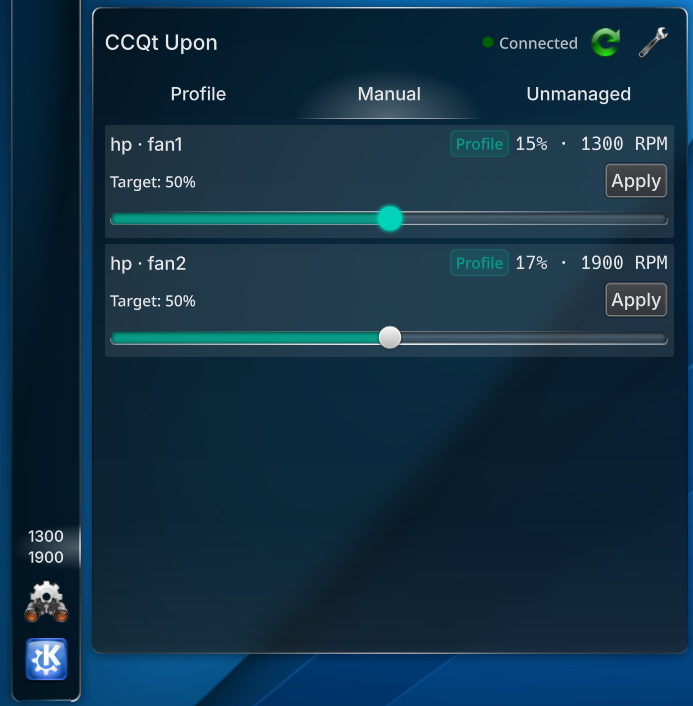

# CCQt Upon

**CCQt Upon** is an ultra-lightweight, native **C++20 + Qt6 Widgets** desktop client for [`coolercontrold`](https://gitlab.com/coolercontrol/coolercontrol) (`v5.1+`), accompanied by a standalone **Plasma 6 QML panel widget** (`org.ccqtupon.fan.plasmoid`).

Built strictly on `Qt6::Widgets` and `Qt6::Network` with **zero Qt StyleSheets (`setStyleSheet`)**, zero WebEngine, and zero Electron, the desktop app integrates natively with Qt styles (Breeze, Fusion, Kvantum), Wayland compositors, and fractional DPI scaling.

---

## Features

### Desktop Application (`ccqtupon`)
- **Overview Tab:** Live temperatures, fan duty percentages, RPM speeds, power/frequency/load metrics, `QPainter` sparklines/bars, CoolerControl Mode switcher, and quick channel profile assignment/reset.
- **Cooling Tab:**
  - Controllable fan channel list plus saved Profiles & Functions sidebar.
  - **120-second Live Fan History** chart (`Duty %` & `RPM`).
  - **Profile Mode:** Interactive `QPainter` fan-curve editor synced bidirectionally with an editable **Points** table.
  - **Manual Mode:** Synchronized slider, spinbox, and `QPainter` semicircular needle gauge showing live vs. target duty.
  - **Unmanaged Mode:** Hands fan control back to hardware / BIOS defaults.
- **Integration & Localization:** English UI by default with instant live switching to Turkish (`Türkçe`), plus an **Open in CoolerControl** button (`coolercontrol` binary with browser URL fallback).

### Standalone Plasma 6 Panel Widget (`org.ccqtupon.fan.plasmoid`)
- Pure QML (Kirigami / PlasmaComponents3) — **no C++ compilation required**.
- Dynamically discovers all controllable fan channels (`fixed_enabled == true`) without assuming a fixed fan count.
- **3 Selectable Panel Display Modes:**
  1. **Icon only** (pauses background polling while closed and immediately refreshes on popup open)
  2. **Fan RPM** (horizontal or vertical layout adapting to panel orientation)
  3. **Fan Duty (%)**
- **Popup Controls:** Active daemon mode badges (`Profile` / `Manual` / `Unmanaged`) per fan, inline **Profile** selector with live mini-curve canvas, **Manual** duty slider, and **Unmanaged** reset controls.

---

## Screenshots









---

## Requirements

- **Runtime (Desktop App):**
  - `coolercontrold` (`v5.1+`) running locally or reachable via HTTP/HTTPS
  - Qt6 Base (`Qt6::Widgets`, `Qt6::Network`)
- **Build:**
  - CMake `>= 3.24`
  - Ninja (or another CMake generator)
  - C++20 compatible compiler
- **Optional:**
  - `coolercontrol` (launched via **Open in CoolerControl**)
  - KDE Plasma 6 (`plasma-workspace`, `kpackagetool6`) for `org.ccqtupon.fan.plasmoid`

---

## Access Token Setup

Both the desktop app and the Plasma 6 widget authenticate with `coolercontrold` using a Bearer Access Token (`cc_...`):

1. Open the official **CoolerControl** desktop app or web interface.
2. Click **Access** in the bottom-left corner → **Access Tokens**.
3. Enter a **Label** (for example `CCQt Upon`).
4. Leave **Expiry Date** empty for a non-expiring token (or choose an expiration date).
5. Enable **Write Access** if you want to switch CoolerControl Modes, apply fan curves, or set manual fan speeds (without Write Access, endpoints remain readable and write requests return HTTP 403).
6. Click **Create Token**, copy the generated `cc_...` token, and paste it into **Connection Settings** in CCQt Upon (or the widget's **Configure → General** page).

> **Local Token Storage Note:**
> When saving the token locally is enabled in the desktop app, configuration and token are written in plaintext to `~/.config/ccqtupon/ccqtupon.conf` with restricted `0600` file permissions. In the Plasma 6 widget, the token is stored in plaintext inside Plasma's standard applet configuration.

---

## Building from Source

```bash
cmake -B build -G Ninja -DCMAKE_BUILD_TYPE=Release
cmake --build build
ctest --test-dir build --output-on-failure
```

To install system-wide (binary, `.desktop` file, and Plasma 6 widget):

```bash
cmake --install build
```

Pass `-DINSTALL_PLASMOID=OFF` at configure time if you only want to install the `ccqtupon` desktop application and `.desktop` entry.

---

## Installation

### Arch Linux (`PKGBUILD`)

Build and install from [`packaging/PKGBUILD`](packaging/PKGBUILD):

```bash
makepkg -p packaging/PKGBUILD -si
```

Or copy `packaging/PKGBUILD` into a clean directory and run `makepkg -si`.

### Standalone Plasma 6 Widget Only

If you only want the Plasma 6 panel widget without building C++ code, install it for your user with `kpackagetool6`:

```bash
kpackagetool6 -t Plasma/Applet -i plasmoid/org.ccqtupon.fan.plasmoid
```

To upgrade an existing installation or remove it later:

```bash
# Upgrade
kpackagetool6 -t Plasma/Applet -u plasmoid/org.ccqtupon.fan.plasmoid

# Remove
kpackagetool6 -t Plasma/Applet -r org.ccqtupon.fan.plasmoid
```

---
---

## AI Notice

CCQt Upon's architecture, design constraints, and user experience were designed and directed by a human author. The C++20, Qt6 Widgets, QML, and Kirigami source code was 100% generated using LLM coding agents.

------
## License

Licensed under the [MIT License](LICENSE).
